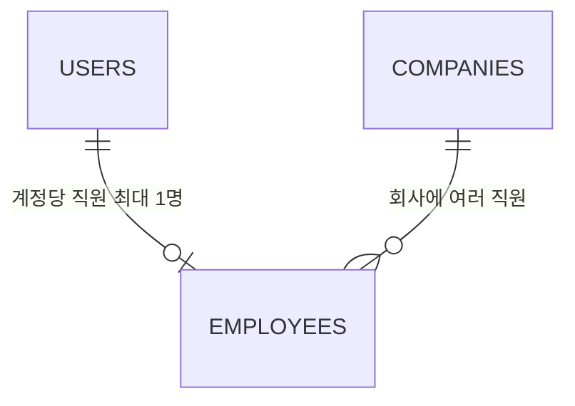
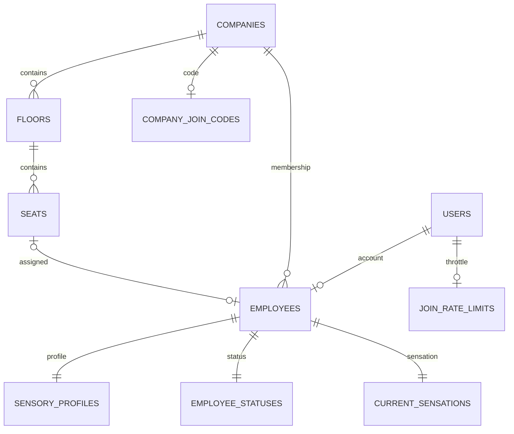

# SenseSpace P1 — DB 스키마 명세서

> 006 후속 구현: employees.temporary_seat_id, employee_statuses.away_reason_text, 내부 통합 점유 테이블 private.seat_claims를 추가한다. 기본/자유 사유는 상호 배제하고 이동·복귀·실제 출근 시 감각은 모두 NULL이다. [006 SQL](./006_seat_movement.sql)과 [동작·API 계약](./자리이동_복귀_API.md)이 아래 초기 P1 설명보다 우선한다. 로컬 검증 완료이며 사용자가 Supabase 적용·설치 확인 성공을 확인했다. 실제 직원 세션과 FE 통합 검증은 남아 있다.

> 2026-11-01 후속 확장: 004에서 메시지를 20자로 제한하고 독립 이모티콘·캐릭터·팀·알림을 추가한다. 005는 실제 FE 항목 52개를 등록한다. 기존 감각은 6개를 유지하며 조명을 추가하지 않는다. AI 생성은 사용자 요청으로 보류한다. 001은 이전 설치 이력으로 보존한다.

작성일: 2026-10-31

상태: P1 전체 설계 및 초기화 SQL 작성 완료. PostgreSQL 17에서 설치·권한·동시성 검증 완료. 실제 Supabase 프로젝트 적용 및 Auth·Storage HTTP 통합 검증 전이다.
기준 문서: [기존 검토 문서](./SenseSpace_P1_검토완료_설계문서.md). 이후 대화에서 확정한 사항은 아래에 기록한다.

## 1. 대화에서 확정한 사항

| 항목 | 결정 |
|---|---|
| 연동 방식 | FE에서 Supabase를 직접 호출한다. |
| 회사 소속 | 한 계정은 한 회사에만 가입할 수 있다. 회사에는 여러 직원이 가입할 수 있다. |
| 퇴근 후 좌석 | 선택한 좌석을 유지한다. 다른 직원이 선택할 수 있는 빈 좌석으로 바뀌지 않는다. |
| 퇴근 후 상태 메시지 | 퇴근 처리 시 함께 지운다. |
| 상태 메시지 입력 가능 상태 | 출근·자리 비움에서만 작성·수정할 수 있다. 퇴근 상태에서는 차단한다. |
| 메시지 최대 길이 | DB에서 20자. 004 적용 필요 |
| 빠른 상태 | 이모티콘만 저장. 메시지와 근태를 바꾸지 않음 |
| 업무 정보 탭 | 이름·직책·층·위치, 시각·청각·후각 민감도, 근태 |
| 감각·AI | 기존 6개 유지. OpenAI 생성은 추후로 보류 |

인증 계정 생성과 회사 가입은 별개다. 가입 코드를 입력하기 전에는 회사 소속이 없는 계정도 존재한다. 회사 변경·탈퇴 절차는 아직 정하지 않았다.

## 2. 계정과 회사 소속 관계

- `auth.users`: Supabase가 관리하는 로그인 계정.
- `companies`: 회사 정보.
- `employees`: 계정의 회사 소속과 직원 정보.
- 한 계정에 연결되는 직원 행은 0개 또는 1개다. 회사 가입을 완료하면 1개가 된다.

위 USERS는 `auth.users`를 의미한다.

## 3. employees — 직원

아래 자료형과 규칙은 [전체 초기화 SQL](./001_sensespace_init.sql)에 반영했다.

| 컬럼 | 자료형 | NULL 허용 | 역할 / 규칙 |
|---|---|---|---|
| id | uuid | 아니요 | PK. 직원 고유 ID |
| user_id | uuid | 아니요 | auth.users.id를 참조하는 FK. UNIQUE |
| company_id | uuid | 아니요 | companies.id를 참조하는 FK |
| seat_id | uuid | 예 | 미선택이면 NULL. UNIQUE. 같은 회사 좌석만 연결 |
| temporary_seat_id | uuid | 예 | 006 추가. 같은 회사의 임시 목적지. 배정 좌석과 다르며 배정이 있어야 설정 가능 |
| name | text | 아니요 | 표시 이름. 공백만 있는 이름 금지 |
| job_title | text | 아니요 | 직책. 미입력 기본값은 빈 문자열 |
| role | text | 아니요 | member / admin. 기본 member. FE 직접 변경 금지. admin 값만으로 관리 권한을 부여하지 않음 |
| created_at | timestamptz | 아니요 | 생성 시각. 기본 now() |
| updated_at | timestamptz | 아니요 | 생성 시 now(), 수정 시 트리거가 서버 시각 기록 |

PK는 각 행을 구별하는 기본키, FK는 다른 테이블의 행을 연결하는 외래키, UNIQUE는 중복을 막는 규칙이다.

### 한 회사 가입을 보장하는 규칙

기존 문서의 `UNIQUE(user_id, company_id)` 대신 `UNIQUE(user_id)`를 사용한다. 기존 규칙은 계정과 회사의 조합만 중복을 막으므로 한 계정이 서로 다른 회사에 가입할 수 있다.

`company_id`에는 UNIQUE를 걸지 않는다. 한 회사에 여러 직원이 가입해야 하기 때문이다.

### 회사 가입 API에 미치는 영향

| 현재 소속 | 요청 | 설계안 |
|---|---|---|
| 없음 | 유효한 코드로 가입 | 직원 및 하위 데이터 생성 |
| A 회사 | A 회사 코드로 재요청 | 기존 employee_id 반환. 기존 정보 유지 |
| A 회사 | B 회사 코드로 가입 | 거부. 업무 오류: ALREADY_JOINED_COMPANY |

가입 함수는 계정별 트랜잭션 잠금과 `UNIQUE(user_id)`로 동시에 서로 다른 회사에 가입해도 최종 소속이 하나만 생성되도록 한다. 업무 오류는 가입 API 응답의 error_code로 반환한다.

FE는 로그인 후 회사 가입 여부를 확인하고 소속 회사로 진입한다. 복수 회사 선택·전환 UI는 필요하지 않다. 다른 회사 데이터 접근을 막는 DB 권한 검사는 계속 필요하다.

## 4. 좌석과 퇴근의 관계

좌석 배정과 출퇴근 상태는 별도 데이터다. `employees.seat_id`는 배정된 좌석을 가리키고, `employee_statuses.status`는 현재 출퇴근 상태를 나타낸다.

| 동작 | 좌석 | 상태 | 현재 감각 6개 | 상태 메시지 |
|---|---|---|---|---|
| 출근 | 기존 배정 유지 | working | 실제 off_work→working 전환에서 모두 NULL(006) | 유지 |
| 자리 비움 | 기존 배정 유지 | away | 기존 입력 유지 | 유지 |
| 임시 이동·복귀 | 배정 유지, 목적지 별도 관리 | 이동 away / 복귀 working | 모두 NULL(006) | 유지 |
| 퇴근 | 기존 배정 유지 | off_work | 모두 NULL로 초기화 | 삭제 |

- 퇴근 RPC는 상태 변경·자리 비움 사유 초기화·현재 감각 초기화·상태 메시지 삭제를 같은 트랜잭션으로 처리하며, `employees.seat_id`는 변경하지 않는다. 하나라도 실패하면 전체를 취소한다.
- 메시지 삭제는 `status_message = ''`로 저장한다. 감각 초기화는 각 필드를 NULL로 저장한다.
- 이미 퇴근 상태에서 퇴근 요청을 다시 보내도 메시지와 감각을 초기화한다.
- 좌석 점유 여부는 배정된 `seat_id`로 판정한다. 출근한 직원만 점유 조회에 포함하면 안 된다.
- 퇴근한 직원의 좌석도 배정된 좌석이다. 미니맵에서 빈 좌석과 구별한다. 구체적인 비활성 스타일은 FE 협의 사항이다.
- 다른 직원이 퇴근자의 좌석을 선택해도 중복 좌석 오류를 반환한다.
- 좌석 변경·해제는 별도 좌석 API로 처리한다. 기존 RPC 계약에 따라 NULL을 이용한 명시적 해제를 지원하며 UI 제공 여부는 FE 결정이다.
- 퇴근 시 개인 민감도·설명은 기존 요구사항대로 유지한다.

검증 시나리오: A가 좌석 S를 선택하고 감각과 메시지를 입력한 뒤 퇴근한다. A의 seat_id는 S이고 현재 감각은 모두 NULL, 메시지는 빈 문자열이어야 한다. B의 S 선택은 실패하며, A가 다시 출근해도 S 배정은 유지되고 이전 메시지·감각은 복원되지 않아야 한다. 로컬 검증 내용은 검토 결과 문서를 참조한다.

### 상태 메시지 변경 규칙

- 출근(working)·자리 비움(away)에서만 본인 메시지 작성·수정·삭제를 허용한다. 퇴근(off_work)에서는 메시지 변경 요청을 거부한다.
- UI의 입력 비활성화와 별개로 DB 함수에서도 상태와 본인 여부를 검사한다.
- 메시지 수정은 RPC `set_status_message`로 처리한다. 일반 직원에게 `employee_statuses` 직접 UPDATE 권한을 부여하지 않는다.
- 메시지 RPC도 상태·감각 RPC와 동일하게 해당 직원의 상태 행을 먼저 잠그고 현재 상태를 검사한 뒤 수정한다. 잠금은 트랜잭션이 끝날 때까지 유지한다.
- 메시지 저장이 먼저 완료되면 다음 퇴근 요청이 메시지를 지운다. 퇴근이 먼저 완료되면 뒤의 메시지 저장은 EMPLOYEE_NOT_WORKING으로 거부한다. 두 요청이 모두 끝난 후 퇴근 상태에 메시지가 남지 않아야 한다.
- 퇴근 RPC 내부의 메시지 초기화는 사용자 메시지 수정과 구별한다. 퇴근 재요청의 초기화는 계속 허용한다.

로컬 검증: 퇴근 상태의 메시지 RPC 및 직접 UPDATE 차단, 메시지 저장과 퇴근의 양방향 동시 요청 후 최종 off_work·빈 메시지를 확인했다.

## 5. 전체 데이터 사전

공통: UUID PK는 서버 `gen_random_uuid()`로 생성한다. 시간은 timestamptz이며 API에서 ISO 8601로 전달한다. 아래에서 NULL 표시가 없는 컬럼은 NOT NULL이다. length 제한은 PostgreSQL 문자 수 기준이다. 이름과 좌석명은 공백만 입력할 수 없다.

### companies — 회사

| 컬럼 | 자료형 | 규칙 |
|---|---|---|
| id | uuid | PK |
| name | text | 이름 1~100자 |
| created_at | timestamptz | 기본 now() |

### floors — 층과 지도

| 컬럼 | 자료형 | 규칙 |
|---|---|---|
| id | uuid | PK |
| company_id | uuid | companies.id FK |
| floor_number | integer | 회사 안에서 유일. 지하층 음수 허용 |
| map_path | text | 버킷 내부 경로. `<company_id>/<floor_id>/<version>/map.png`. 회사·층 접두사 검증, `..` 금지 |
| map_width | integer | 원본 지도 너비. 0 초과 |
| map_height | integer | 원본 지도 높이. 0 초과 |
| created_at | timestamptz | 기본 now() |

`UNIQUE(company_id,floor_number)`, `UNIQUE(company_id,id)`. signed URL은 저장하지 않는다. 지도 파일은 별도 Storage 업로드가 필요하다.

### seats — 좌석

| 컬럼 | 자료형 | 규칙 |
|---|---|---|
| id | uuid | PK |
| company_id | uuid | companies.id FK |
| floor_id | uuid | company_id와 함께 floors(company_id,id) 복합 FK |
| label | text | 좌석명 1~50자 |
| x_ratio | numeric | 0~1. 원본 지도 왼쪽에서 오른쪽 방향 |
| y_ratio | numeric | 0~1. 원본 지도 위에서 아래 방향 |
| created_at | timestamptz | 기본 now() |

`UNIQUE(floor_id,label)`, `UNIQUE(company_id,id)`. 좌표는 좌석 아이콘의 중심이다. 원본 종횡비를 유지하고 contain 여백을 제외한 실제 지도 크기에 비율을 곱한다.

직원의 `(company_id,seat_id)`는 seats의 `(company_id,id)`를 참조한다. 층·좌석을 운영자가 수정할 때에도 회사 관계가 어긋나지 않도록 DB가 검사한다.

### sensory_profiles — 평소 민감도

| 컬럼 | 자료형 | 규칙 |
|---|---|---|
| employee_id | uuid | PK + employees.id FK |
| visual_sensitivity | smallint | NULL 또는 1~5 |
| auditory_sensitivity | smallint | NULL 또는 1~5 |
| olfactory_sensitivity | smallint | NULL 또는 1~5 |
| description | text | 기본 빈 문자열. 최대 1,000자 |
| updated_at | timestamptz | 기본 now(), 수정 시 자동 갱신 |

평소 민감도는 현재 감각과 별도이며 퇴근해도 유지한다. NULL은 미입력이다. 1 낮음 / 3 보통 / 5 높음은 표시 기본안이다.

### employee_statuses — 근무 상태와 상태 메시지

| 컬럼 | 자료형 | 규칙 |
|---|---|---|
| employee_id | uuid | PK + employees.id FK |
| status | text | working / away / off_work. 기본 off_work |
| away_reason | text | NULL 허용. away면 lunch / meeting / outside 중 하나 필수, 그 외 NULL |
| status_message | text | 기본 빈 문자열. 004 후 최대 20자. off_work이면 반드시 빈 문자열 |
| quick_emoji_id | text | 004 추가. NULL 또는 quick_emojis.id FK. 메시지·근태와 독립 |
| updated_at | timestamptz | 기본 now(), 수정 시 자동 갱신 |

상태 전이 기본안: off_work → working → away, away → working, working/away → off_work. away → away 사유 변경과 같은 상태 재요청도 허용한다. off_work → away 직접 변경은 금지한다. 로그인·로그아웃·브라우저 종료로 상태를 자동 변경하지 않는다. 좌석 없이 출근은 기존 기본안대로 허용한다.

### current_sensations — 현재 체감

| 컬럼 | 자료형 | 의미 / 1 → 3 → 5 |
|---|---|---|
| employee_id | uuid | PK + employees.id FK |
| temperature_level | smallint | 매우 추움 → 적당함 → 매우 더움 |
| humidity_level | smallint | 매우 건조함 → 적당함 → 매우 습함 |
| noise_level | smallint | 매우 조용함 → 보통 → 매우 시끄러움 |
| odor_level | smallint | 거의 없음 → 보통 → 매우 강함 |
| discomfort_level | smallint | 매우 쾌적함 → 보통 → 매우 불쾌함 |
| crowd_level | smallint | 매우 한산함 → 보통 → 매우 혼잡함 |
| updated_at | timestamptz | 기본 now(), 수정 시 자동 갱신 |

감각 6개는 각각 NULL 또는 1~5 정수다. NULL을 0이나 3으로 바꾸지 않는다. 사람이 입력한 체감이며 센서 실측·섭씨·상대습도·공식 계산 지수가 아니다. working/away에서만 수정한다.

### private.company_join_codes — 회사별 가입 코드

| 컬럼 | 자료형 | 규칙 |
|---|---|---|
| company_id | uuid | PK + companies.id FK. 회사당 현재 코드 1개 |
| code_hash | text | UNIQUE. 64자리 소문자 hex SHA-256 |
| expires_at | timestamptz | NULL이면 무기한. 만료 시 신규 가입 차단 |
| revoked_at | timestamptz | NULL이 아니면 폐기 |
| created_at | timestamptz | 기본 now() |

원문 코드는 12바이트 난수의 대문자 hex 24자리다. 입력은 앞뒤 공백 제거·대문자 변환 후 해시 비교한다. 만료·폐기·잘못된 코드는 같은 오류로 응답한다. 코드 교체·폐기는 기존 소속에 영향을 주지 않는다.

### private.join_rate_limits — 가입 호출 제한

| 컬럼 | 자료형 | 규칙 |
|---|---|---|
| user_id | uuid | PK + auth.users.id FK |
| window_started_at | timestamptz | 1분 제한 구간 시작 시각 |
| attempts | integer | 양수. 구간 안 모든 가입 호출을 집계 |

계정당 1분에 5회 허용한다. 실패 시도도 저장하려고 가입 RPC의 업무 오류는 예외 대신 JSON으로 반환한다. 계정별 제한이며 IP 제한·여러 계정 악용 방어까지 구현한 것은 아니다. Auth 가입 제한은 Supabase Auth 설정에서 별도 관리한다.

## 6. 생성·삭제·인덱스·권한

- 직원 INSERT 트리거가 프로필·상태·감각 행을 각각 생성한다. 가입과 하위 행 생성은 함께 성공하거나 함께 취소된다. 초기 상태는 off_work, 메시지·설명은 빈 문자열, 민감도·감각은 NULL이다.
- 직원당 하위 3개 테이블은 PK/FK로 최대 1행이다. 누락 방지는 생성 트리거와 일반 직원의 INSERT/DELETE 금지로 보장한다. 운영자는 하위 행을 임의 삭제하지 않는다.
- auth.users 삭제 시 직원과 하위 데이터, 해당 계정의 가입 호출 제한 행을 CASCADE 삭제한다. 직원 삭제 시 좌석 자체는 유지된다. 회사·층·좌석의 참조 중 삭제는 기본 NO ACTION으로 거부한다. 삭제·탈퇴 UI는 P1 범위 밖이다.
- PK/UNIQUE 인덱스 외 `employees(company_id,id)`, `seats(company_id,floor_id)` 인덱스를 추가한다.
- 모든 public 업무 테이블 및 private 테이블에 RLS를 켠다. 일반 직원은 같은 회사 데이터만 읽고, 이름·직책과 민감도·설명만 본인 행의 허용 컬럼을 직접 수정한다.
- 직원 조회에 user_id·role을 공개하지 않는다. 내 소속 확인은 `get_my_membership` RPC를 사용한다. 직원 SELECT에는 반드시 허용 컬럼을 지정하며 `select('*')`를 사용하지 않는다.
- 좌석·상태·감각·메시지는 RPC만 수정한다. 일반 직원의 직접 INSERT/DELETE, 회사 ID·계정 ID·역할 변경은 금지한다.
- public 함수는 SECURITY INVOKER, 권한 상승 함수는 API 비노출 private 스키마에 배치한다. 권한 상승 함수는 search_path를 비우고 auth.uid()와 본인 소유권을 검사한다. 잠금 전용 함수는 일반 직원에게 EXECUTE를 주지 않는다.
- 회사·지도·좌석·코드 설정은 SQL Editor의 postgres 운영 경로만 제공한다. FE에 service_role/secret key를 넣지 않는다. admin 역할 값은 관리 UI 권한을 자동 제공하지 않는다.
- `office-maps` 비공개 버킷을 생성한다. 직원은 소속 회사 접두사 파일만 SELECT할 수 있다. 일반 직원의 업로드·수정·삭제는 허용하지 않는다.

## 7. ERD

## 8. 설계 범위와 기본안

기존 검토 문서에서 복수 회사 소속, 퇴근 시 메시지 유지, 메시지 직접 UPDATE 부분은 이번 문서로 대체한다. 이력 저장·근태 시간 집계·센서·추천·지도 편집기·직원 탈퇴·기업 관리자 UI는 P1 범위 밖이다.

사용자 확정과 구별되는 구현 기본안: 문자열 길이(회사·직원명·직책 100 / 좌석명 50 / 설명 1,000), 민감도 초기 NULL, off_work→away 금지, 좌석 없는 출근 허용, 명시적 좌석 해제 지원, 계정당 가입 제한 5회/분, 활성 탭 5초 재조회. 메시지 20자는 사용자 확정이다. 제품 확정이 추가되면 후속 마이그레이션으로 조정한다. 색상 팔레트·민감도 세부 문구·토글 복수 선택은 FE 표시 정책이며 저장 스키마에는 영향을 주지 않는다.

## 9. 004 후속 테이블

| 테이블 / 필드 | 컬럼과 규칙 |
|---|---|
| quick_emojis | id text PK, emoji text UNIQUE, label text, sort_order integer. 실제 FE의 12개 이모티콘 |
| teams | id uuid PK, company_id FK, name 1~100자. UNIQUE(company_id,name), UNIQUE(company_id,id) |
| employees.team_id | NULL 또는 teams 복합 FK(company_id,team_id). 다른 회사 팀 금지. 일반 직원 수정 금지 |
| avatar_categories | id text PK, label, required_for_basic boolean, sort_order. hair_style/hair_color/eye_color/outfit/outfit_color/special_skin/gender |
| avatar_items | PK(category_id,item_id), category_id FK, label, asset_path NULL 허용, metadata JSON 객체, enabled boolean, sort_order |
| employee_avatars | employee_id PK/FK ON DELETE CASCADE, selections JSON 객체 기본 {}, is_complete boolean 기본 false, updated_at 자동 갱신 |
| notifications | id uuid PK, employee_id FK ON DELETE CASCADE, kind system/seat_changed, title 1~100자, body 최대 500자 기본 빈 문자열, read_at NULL 허용, created_at 기본 now() |
| private.sensespace_migrations | version text PK, applied_at. 004 중복 적용 차단용. API 접근 금지 |

위 컬럼은 NULL 허용이라고 표시한 항목 외에는 NOT NULL이다. 004 후 public 테이블은 13개, private는 3개다. 기존 직원에게 캐릭터 행을 보충하고 신규 직원 생성 트리거도 확장한다. 계정·회사·좌석·지도 데이터는 재생성하지 않는다.

캐릭터는 본인 RPC만 수정, 같은 회사 직원은 조회한다. 카탈로그는 운영자만 변경하고 기존 항목은 삭제보다 비활성화해 렌더링 정보를 유지한다. 팀은 소속 회사만 조회하고 알림은 본인만 조회·읽음 처리한다. 카탈로그·팀·알림 직접 변경은 일반 직원에게 허용하지 않는다.

005의 항목 52개는 실제 character.js에서 생성했다. 그림은 FE의 SVG 코드에 있으므로 asset_path는 NULL이고 metadata에 FE 인덱스와 색상 등이 있다. gender는 그림 실루엣 선택이다. 독립 이모티콘의 퇴근 중 변경/유지와 본인 좌석 변경 알림은 구현 기본안이며 사용자 추가 결정과 구별한다. 세부 API·적용 순서·검증은 [FE 코드 연동 검토](./FE_코드_연동_검토.md)를 따른다.

공식 근거: [RLS](https://supabase.com/docs/guides/database/postgres/row-level-security), [함수 권한](https://supabase.com/docs/guides/database/functions), [Storage 권한](https://supabase.com/docs/guides/storage/security/access-control).
